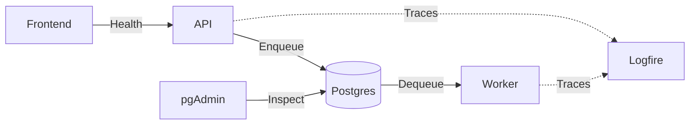

| Component | Role | Technology |
| --------- | ---- | ---------- |
| Frontend service | Presents the user interface. | [Next.js](https://nextjs.org/), [React](https://react.dev/), [TypeScript](https://www.typescriptlang.org/), [Tailwind CSS](https://tailwindcss.com/), [shadcn/ui](https://ui.shadcn.com/) (configured) |
| API service | Validates requests and enqueues workflows. | [FastAPI](https://fastapi.tiangolo.com/), [Pydantic](https://docs.pydantic.dev/), [Uvicorn](https://www.uvicorn.org/) |
| Worker service | Runs workflows. | [Python](https://www.python.org/), [DBOS](https://docs.dbos.dev/) |
| Database | Stores workflow state. | [PostgreSQL](https://www.postgresql.org/) |
| Database administration | Inspects the database. | [pgAdmin](https://www.pgadmin.org/) |
| Observability | Collects and inspects traces. | [Logfire](https://logfire.pydantic.dev/) |

## Task orchestration

`POST /orchestrations/runs` accepts `prompt` and optional structured `data` and returns
an ID and `/runs/{id}` location. The existing run endpoint returns the submitted request,
status, and either `result.output` (text) or a generic error. Individual tasks keep their
existing API and workflow identity.

The worker's `agora.orchestrate.v1` workflow runs a Pydantic AI agent with native
Code Mode. Approved `parse`, `decide`, and `generate` tools derive their contracts
from `TASK_REGISTRY` through `Task.as_tool()`. `supplied_data()` gives the program
structured data without requiring it to embed the data in source. Each task call
invokes `agora.execute.v1` as a child DBOS workflow; its synchronous implementation
runs in a thread with the DBOS context preserved. Both entry points use the same
validation and task implementation path. Internal dummy, workspace, and web tasks
are excluded from this initial orchestration surface.

Each request permits one program, no repair, at most 32 nested calls, 100 sandbox
suspensions, 10 seconds of sandbox execution, and 128 MiB of sandbox memory.
Provider waits do not count toward Monty's execution time. Host filesystem and
environment access are unavailable. These are initial limits, not a run-wide timeout
or cancellation contract. Source persistence and crash/restart guarantees remain
follow-up work (#40 and #41).

Compatibility is tested with Pydantic AI 2.63.0, Harness 0.63.0, Monty 1.4.0, and
DBOS 2.31.1. `worker/tests/test_orchestration_db.py` uses real PostgreSQL and
controlled models to check loop/branch composition and persisted child workflows;
it does not establish replay or exactly-once external effects. Bruno's
`orchestration-live.bru` is an opt-in real-model loop check. It requires OpenAI
access; parse/decide compositions additionally require accessible files and Jev credentials.
