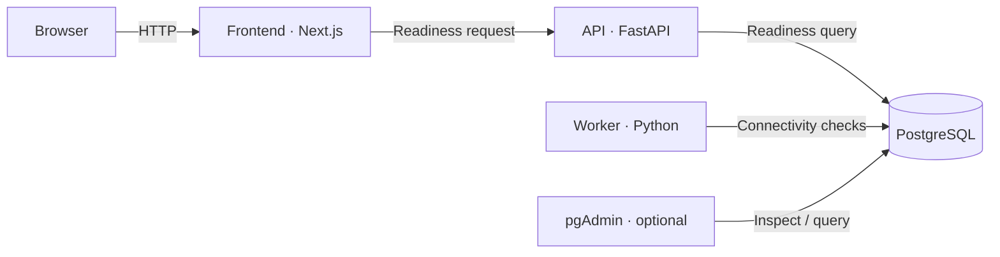

Agora has three independently deployed services: Next.js owns the UI, FastAPI owns HTTP contracts, and the Python worker owns execution. PostgreSQL stores application and future DBOS state; pgAdmin is an optional local inspection tool.

The current worker checks connectivity and handles shutdown. DBOS, Monty, and capability execution follow in Phase 2. API and worker share a uv workspace and lockfile; their containers install only their own runtime dependencies. Published ports bind to localhost; authentication is planned for Phase 7.
