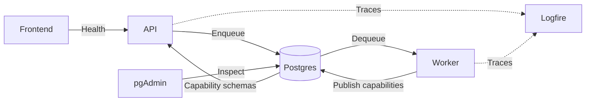

| Component | Role | Technology |
| --------- | ---- | ---------- |
| Frontend service | Presents the user interface. | [Next.js](https://nextjs.org/), [React](https://react.dev/), [TypeScript](https://www.typescriptlang.org/), [Tailwind CSS](https://tailwindcss.com/), [shadcn/ui](https://ui.shadcn.com/) (configured) |
| API service | Validates requests and enqueues workflows. | [FastAPI](https://fastapi.tiangolo.com/), [Pydantic](https://docs.pydantic.dev/), [Uvicorn](https://www.uvicorn.org/) |
| Worker service | Runs workflows and model generation. | [Python](https://www.python.org/), [DBOS](https://docs.dbos.dev/), [Pydantic AI](https://pydantic.dev/docs/ai/) |
| Database | Stores workflow state. | [PostgreSQL](https://www.postgresql.org/) |
| Database administration | Inspects the database. | [pgAdmin](https://www.pgadmin.org/) |
| Observability | Collects and inspects traces. | [Logfire](https://logfire.pydantic.dev/) |

The worker registers operation handlers and publishes their descriptions and JSON Schemas as an
atomic snapshot in `agora.capability_registry` in the existing PostgreSQL database at startup.
The API reads that registry for discovery and input validation, then enqueues a generic operation
and inputs envelope without importing worker code. Results are JSON objects. Adding an operation
requires registering a worker handler, without changing API types or dispatch. Registry metadata
persists while the worker is offline; it describes installed capabilities, not worker liveness.
Worker replicas must run the same capability definitions; mixed-version catalogs are not supported.
The worker constructs an explicit Pydantic AI `Agent`; `DBOSDurability` checkpoints model calls.
An output function supplies the caller's JSON Schema and validates the returned JSON before a
result is saved. The worker validates inputs again using its Pydantic models.

Workflow inputs and final results remain portable JSON. Internal Pydantic AI checkpoints use
DBOS's native Python serialization to preserve typed model responses. Completed model steps are
reused on recovery; interruption before a step is recorded can repeat an external model call.
Recovery across changed worker application versions is not established by same-version restart
tests. Agent telemetry excludes prompt/output and binary content. Keep execution local/private;
application cancellation and per-run call budgets are not implemented.
