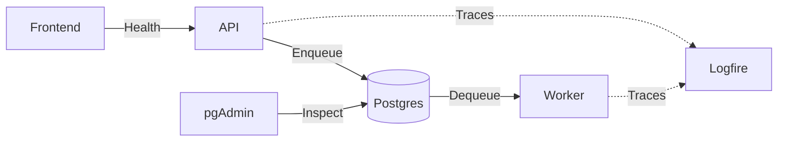

| Component | Role | Technology |
| --------- | ---- | ---------- |
| Frontend service | Presents the user interface. | [Next.js](https://nextjs.org/), [React](https://react.dev/), [TypeScript](https://www.typescriptlang.org/), [Tailwind CSS](https://tailwindcss.com/), [shadcn/ui](https://ui.shadcn.com/) (configured) |
| API service | Validates requests and enqueues workflows. | [FastAPI](https://fastapi.tiangolo.com/), [Pydantic](https://docs.pydantic.dev/), [Uvicorn](https://www.uvicorn.org/) |
| Worker service | Runs workflows. | [Python](https://www.python.org/), [DBOS](https://docs.dbos.dev/) |
| Database | Stores workflow state. | [PostgreSQL](https://www.postgresql.org/) |
| Database administration | Inspects the database. | [pgAdmin](https://www.pgadmin.org/) |
| Observability | Collects and inspects traces. | [Logfire](https://logfire.pydantic.dev/) |
