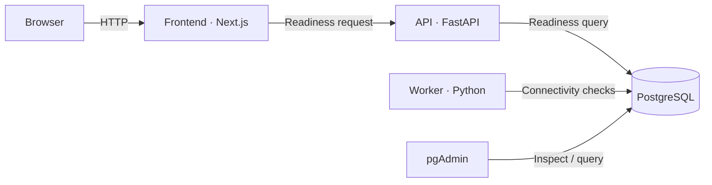

Next.js handles presentation, FastAPI owns HTTP contracts and validation, and the worker owns execution. PostgreSQL stores application state; pgAdmin provides database inspection.

The current stack checks service and database readiness. The worker does not execute capabilities yet.
