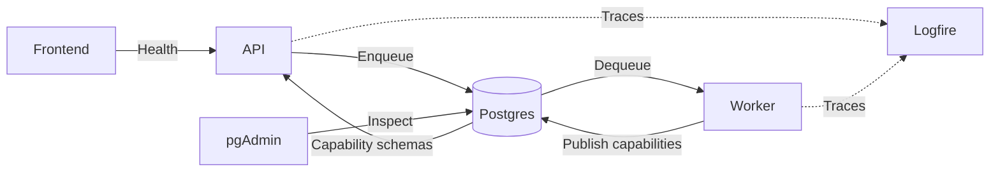

| Component | Role | Technology |
| --------- | ---- | ---------- |
| Frontend service | Presents the user interface. | [Next.js](https://nextjs.org/), [React](https://react.dev/), [TypeScript](https://www.typescriptlang.org/), [Tailwind CSS](https://tailwindcss.com/), [shadcn/ui](https://ui.shadcn.com/) (configured) |
| API service | Validates requests and enqueues workflows. | [FastAPI](https://fastapi.tiangolo.com/), [Pydantic](https://docs.pydantic.dev/), [Uvicorn](https://www.uvicorn.org/) |
| Worker service | Runs workflows and model generation. | [Python](https://www.python.org/), [DBOS](https://docs.dbos.dev/), [Pydantic AI](https://pydantic.dev/docs/ai/) |
| Database | Stores workflow state. | [PostgreSQL](https://www.postgresql.org/) |
| Database administration | Inspects the database. | [pgAdmin](https://www.pgadmin.org/) |
| Observability | Collects and inspects traces. | [Logfire](https://logfire.pydantic.dev/) |

The worker defines capabilities as functions with Pydantic input and output models. At startup,
it publishes their JSON Schemas to PostgreSQL. The API reads this catalog for discovery and
submission; capability implementations stay in the worker.

Generation runs a Pydantic AI `Agent` through `DBOSDurability`. Public inputs and results are
JSON; internal model checkpoints use DBOS Python serialization. Recovery reuses completed steps,
but an interrupted model call can repeat. Agent telemetry excludes prompt and output content.
